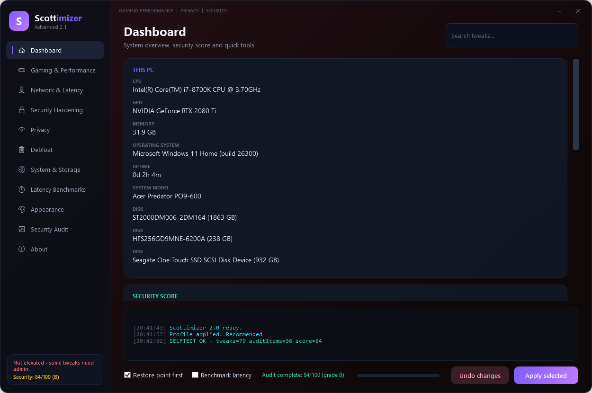
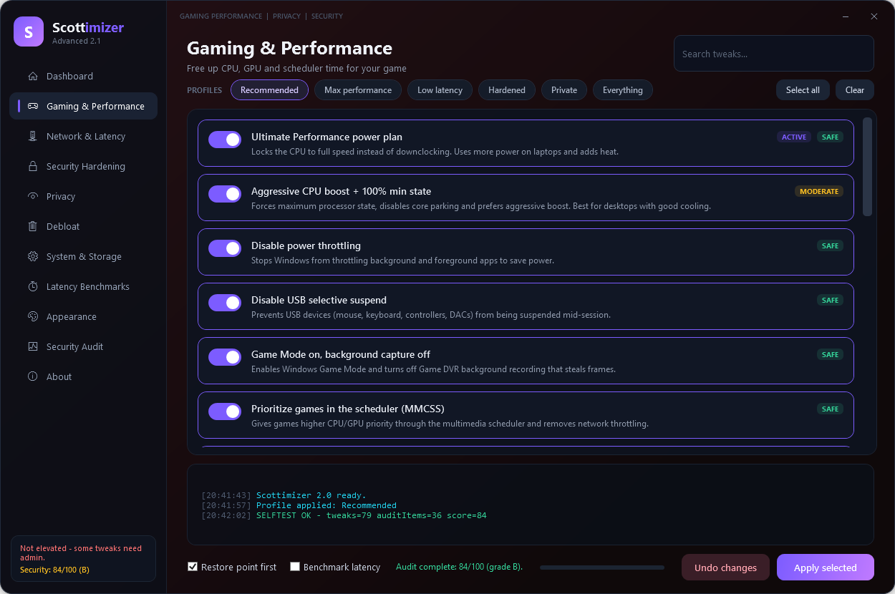
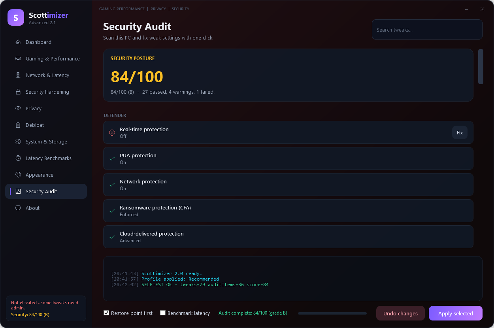
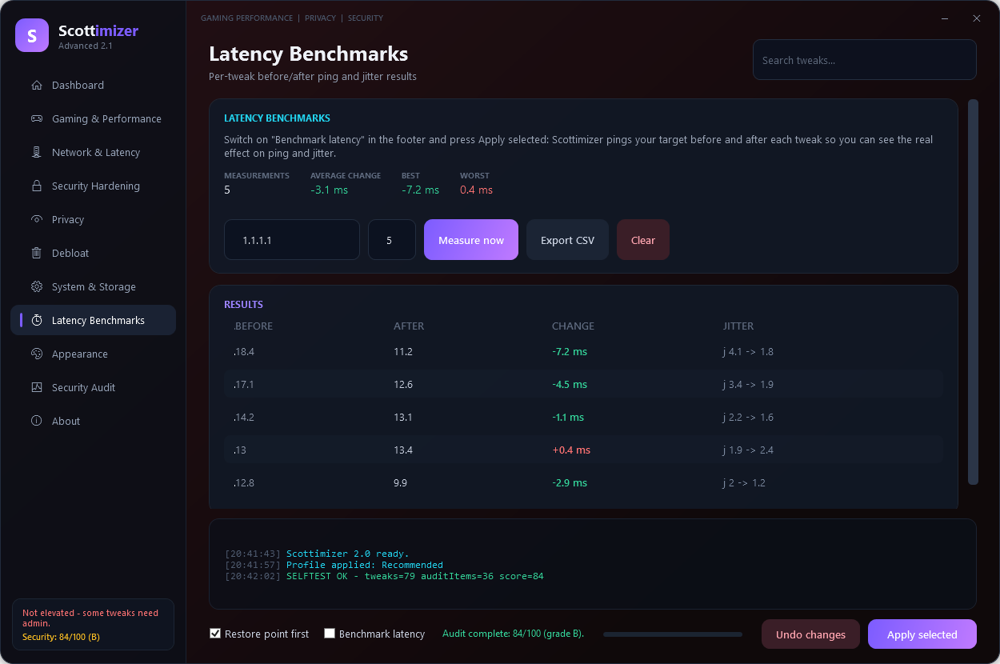
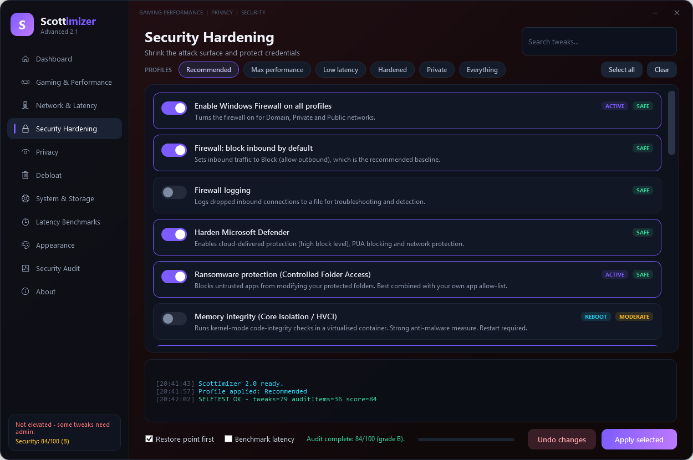
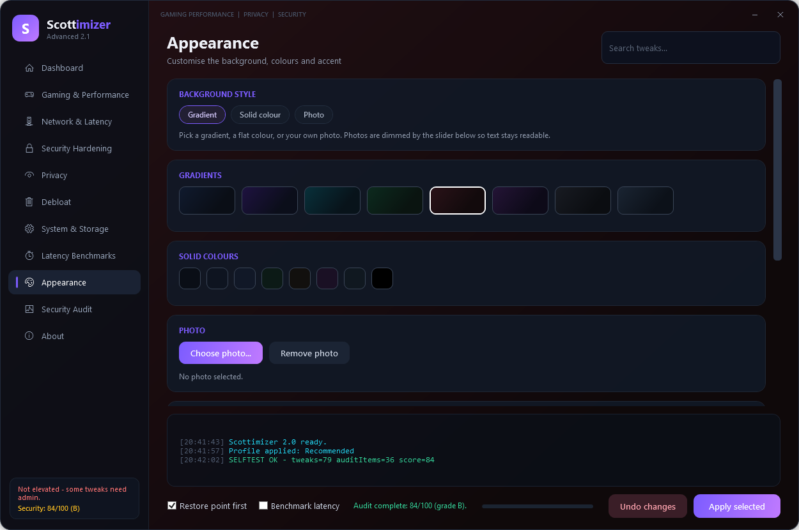

# Scottimizer 2 — Advanced Gaming, Privacy & Security Tuner


A ground-up upgrade of the original Scottimizer. It keeps the simple
toggle-and-apply idea but adds **79 tweaks across 6 categories**, a
**one-click security audit and auto-fix**, an **exact-state snapshot engine**
for real undo, **per-tweak latency benchmarking**, a **fully customisable
look** (photos, gradients, colours, accent), a live dashboard, quick
maintenance tools, profiles, search, and a modern dark UI.

> Inspired by the approach of Chris Titus' Windows Utility, focused on gaming
> performance **plus** privacy and security hardening — without ever turning
> off Defender, the firewall or Windows Update.

---

## Download

Get the latest build from the **[Releases page](../../releases/latest)**:

* **`Scottimizer-Advanced.zip`** — the complete app (compiled `Scottimizer.exe`
  plus the scripts). Unzip anywhere and run.
* Prefer no `.exe`? Clone the repo and double-click **`Scottimizer.bat`** — it
  runs from source and behaves identically.

> **First run:** the app self-elevates, so accept the Administrator prompt.
> The `.exe` is unsigned, so SmartScreen may show *"Windows protected your PC"*
> the first time — click **More info → Run anyway**, or use `Scottimizer.bat`
> to avoid the warning entirely.

Installing with a package manager? The winget manifest is
[submitted and pending review](https://github.com/microsoft/winget-pkgs/pull/453051) —
once merged you can run `winget install SCOTTYinCntrl.Scottimizer`.

---

## Quick start

1. Unzip the folder anywhere (do **not** run from inside the zip).
2. Double-click **`Scottimizer.exe`** (or `Scottimizer.bat`) and accept the
   Administrator prompt.
3. Pick a **profile** (top of the window) or flip individual switches.
4. Press **Apply selected**, then restart if it tells you to.
5. Changed your mind? **Undo changes** restores your exact previous settings.

Works on Windows 10 and Windows 11 (Windows PowerShell 5.1). Administrator is
required for most tweaks — the app elevates itself.

---

## Screenshots

| Dashboard | Gaming & Performance |
|---|---|
|  |  |

| Security Audit | Latency Benchmarks |
|---|---|
|  |  |

| Security Hardening | Appearance |
|---|---|
|  |  |

---

## What makes it advanced

### 1. Categories & content
| Tab | What it covers |
|-----|----------------|
| **Gaming & Performance** | Power plans, CPU boost / core parking, MMCSS game priority, Win32PrioritySeparation, HAGS, GPU TDR timeout, fullscreen optimizations, raw mouse, visual effects, Explorer/menu latency, Delivery Optimization, SysMain, indexing |
| **Network & Latency** | TCP auto-tuning + RSS, advanced TCP (heuristics/timestamps/ECN/RSC), Nagle's algorithm, NIC power saving, Energy Efficient Ethernet, interrupt moderation, QoS reservation, DNS providers (Cloudflare / Cloudflare Security / Quad9), DNS-over-HTTPS, IPv6 toggle |
| **Security Hardening** | Firewall on/block/log, Defender cloud+PUA+network protection, Controlled Folder Access (anti-ransomware), Memory Integrity, LSA protection, WDigest, LM hash, anonymous access, SMBv1, SMB signing, SMB guest, LLMNR, NetBIOS, AutoRun, RDP, Remote Assistance, PowerShell 2.0, SmartScreen, Script Host, file extensions, Guest account, Windows Recall |
| **Privacy** | Telemetry + telemetry services, advertising ID, activity history, location, feedback, consumer/suggested content, Copilot, Widgets, Bing search, Cortana, tailored experiences, background apps |
| **Debloat** | Curated removal of pre-installed Store apps, Cortana app, OneDrive, Teams/Chat button, consumer features |
| **System & Storage** | Fast Startup, hibernation, NTFS last-access, 8.3 names, SSD TRIM |

### 2. Security audit with one-click fixes
The **Security Audit** tab runs ~36 read-only checks (Defender, Firewall, UAC,
Secure Boot, TPM, BitLocker, Memory Integrity, credential protection, SMB/LLMNR/
NetBIOS, RDP, AutoRun, scripting engines, telemetry, updater) and gives a
**0–100 score with a letter grade**. Every failing item that maps to a tweak gets
a **Fix** button that snapshots, applies, and re-scans.

### 3. Real undo (snapshot engine)
Before anything changes, Scottimizer records the **exact prior state** — registry
values *and their types*, service start modes, the active power plan, and DNS
servers — to `state\last-apply.json`.

* **Undo changes → Yes** restores that snapshot exactly.
* **Undo changes → No** resets the selected tweaks to Windows defaults.

It also offers to create a **System Restore point** before applying.

### 4. Profiles
`Recommended` · `Max performance` · `Low latency` · `Hardened` · `Private` ·
`Everything`. Each is a one-click selection across the right tweaks.

### 5. Dashboard & tools
Live system info (CPU / GPU / RAM / OS / uptime / disks), network summary with a
built-in **latency test** (avg / min / max / jitter / loss), security score, and
quick tools: restore point, flush DNS, clear temp, **clear standby memory**,
trim working sets, reset network stack, clear Windows Update cache, DISM
component cleanup, SFC launch, empty Recycle Bin, disk cleanup wizard, reset
power plans.

### 6. Per-tweak latency benchmarking
Tick **Benchmark latency** in the footer and press **Apply selected**: before and
after *every* tweak, Scottimizer pings your target (default `1.1.1.1`) and records
the average ping and jitter. The **Latency Benchmarks** tab shows a summary
(average / best / worst change across measurements) and a colour-coded table —
**green = faster, red = slower**. Results persist in `benchmarks.json`, and the
**Export CSV** button saves them for a spreadsheet. You can also take a one-off
reading with **Measure now**.

### 7. Make it yours (Appearance)
The **Appearance** tab changes the background live:
* **Gradients** — 8 curated presets.
* **Solid colours** — 8 flat presets.
* **Photo** — pick any image, or simply **drag a picture onto the window**.
* **Dim slider** — darkens the photo so text stays readable.
* **Gradient direction** — diagonal / vertical / horizontal.
* **Accent colour** — 8 presets retint the nav highlight, switches, buttons,
  logo and progress bar.

Choices are saved to `settings.json` and restored on the next launch.

### 8. Safety by design
* **Additive security only** — the app never disables Defender, the firewall or
  Windows Update.
* Risk levels on every tweak: **Safe / Moderate / Advanced** (Advanced tweaks are
  off by default; selecting any prompts a confirmation).
* Every action is written to `logs\`.

---

## Files

```
Scottimizer.exe            Compiled standalone app (elevates itself)
Scottimizer.bat            Launch the script version (elevates itself)
Scottimizer.ps1            Main entry point (data + wiring)
appicon.ico                App icon (purple "S" + lightning bolt, 7 sizes)
LICENSE                    MIT license
src\Core.ps1               Snapshot engine, helpers, system info, ping
src\Tools.ps1              Cleanup, memory, network-reset tools
src\Tweaks.ps1             The tweak catalog (79 tweaks)
src\Audit.ps1              Security audit checks
src\Ui.ps1                 XAML theme + UI builders
src\Personalize.ps1        Settings, backgrounds + accent, Appearance page
src\Benchmark.ps1          Per-tweak latency benchmarking + page
src\Actions.ps1            Page building + apply/undo flows
Build-Single.ps1           Merge everything into Scottimizer.Standalone.ps1
Build-EXE.ps1 / .bat       Build the standalone .exe via ps2exe
Make-Icon.ps1              Draws appicon.ico (run again to re-style the icon)
Scottimizer.Standalone.ps1 Generated single-file version
settings.json              Your saved look (background + accent)
benchmarks.json            Saved latency benchmark results
logs\                      Run logs
state\last-apply.json      Snapshot used by Undo
preview\                   UI screenshots
```

## Want to rebuild the .exe?
Run **`Build-EXE.bat`** (or `powershell -File Build-EXE.ps1`). It merges the
`src\` modules into `Scottimizer.Standalone.ps1` and compiles `Scottimizer.exe`
with the free `ps2exe` module (downloaded automatically the first time).
Some antivirus tools flag any ps2exe-built file as suspicious; if that happens,
just keep using `Scottimizer.bat` (identical behaviour, no exe needed).

### The app icon
`appicon.ico` is a purple rounded tile with a bold white **S** and a gold
lightning bolt, shipped at 7 sizes (16–256 px). It is embedded in
`Scottimizer.exe` and shown in the window title bar and taskbar. To restyle it,
edit **`Make-Icon.ps1`** (colours, glyph, bolt) and re-run it:

```
powershell -NoProfile -ExecutionPolicy Bypass -File Make-Icon.ps1
```

It rewrites `appicon.ico` and drops previews in `preview\` (`icon.png`,
`icon-32.png`). Then rebuild the `.exe` so the new icon is embedded.

## Notes & troubleshooting
* **Reboot** where indicated (GPU scheduling, driver timeout, Memory Integrity,
  SMBv1, power plans, IPv6/Nagle).
* Ping gains depend mostly on your connection and route. **A wired connection
  helps more than any tweak.**
* If a tweak fails, the log shows why; most failures are simply "not supported
  on this edition/hardware" and are harmless.
* Advanced/risky items (optimistic PVC in NTFS, disabling IPv6, Script Host,
  interrupt moderation) can affect specific setups — read the description first.
* To fully reset power-related tuning after experimenting, use
  **Quick Tools → Reset power plans**.
* **Desktop icon looks stale or blank?** Windows caches shell icons. Run
  `ie4uinit.exe -ClearIconCache` (or restart Explorer) and the purple icon shows.
  The icon ships with BMP entries at 16–128 px and a PNG at 256 px, which is the
  combination Explorer renders correctly at every size.

## Disclaimer
Use at your own risk. These are real system changes; the snapshot and restore
point exist to make them reversible. Review the descriptions before enabling
anything, especially **Advanced** items.

## License
Released under the [MIT License](LICENSE).
